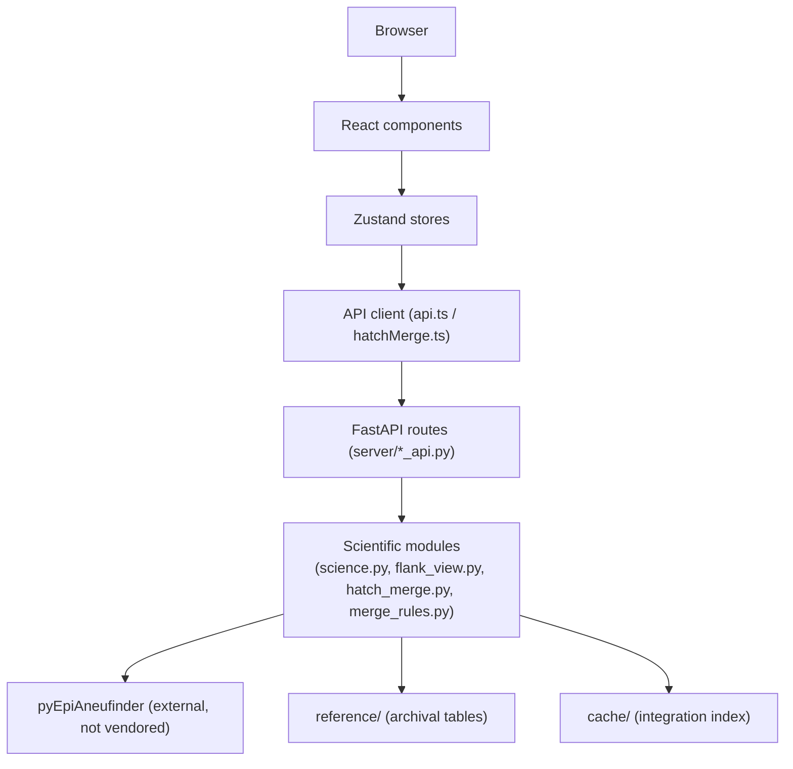

# Architecture

A FastAPI backend (`server/`) serves both a JSON API and the built React
frontend (`web/dist/`). The React/TypeScript/Vite frontend (`web/src/`) uses
Zustand for state and Plotly for genomic tracks and plots. `reference/` holds
archival, verified-reproducible prior-research tables; `validation/` holds
test evidence and screenshots.

## Backend (`server/`)

| Module | Responsibility |
|---|---|
| `run.py` (repo root) | Entry point: CLI args, env var resolution, launches the FastAPI app. |
| `server/app.py` | Assembles the FastAPI app and registers every route module. **Route registration order matters**: API routes must be registered before the SPA static-file catch-all, or they silently receive HTML instead of JSON. |
| `server/config.py` / `server/data.py` | Resolves the data root and its overrides (`PYEPI_SCIENTIFIC_*` env vars), loads the cohort. |
| `server/science.py` / `server/pyepi_adapter.py` | The adapter around the external `pyEpiAneufinder` package — see [LICENSING.md](LICENSING.md). Registers the package directory without executing its `__init__.py` (which eagerly imports plotting/postprocessing modules) and imports the scientific modules directly. Every statistic here is a direct, unmodified call into `pyEpiAneufinder`. |
| `server/experiments.py` / `server/experiment_api.py` | X experiments: region edits (multiply/add/replace/simulate/extend/duplicate), width series, event-edge diagnostics, recursion-depth inspection (k = 1–10), the four CN comparison rows. |
| `server/segment_estimators.py` | Manual segmentation's alternative segment-mean estimators (arithmetic, upper-tail IQR, two-sided IQR). |
| `server/integration.py` / `server/integration_api.py` | Multimodal clustering/pseudobulk data adapter for the Integration tabs — loads the depth + haplotype integration story's exported artifacts read-only (nothing is re-clustered, re-integrated, or re-segmented here), with background indexing/caching under `cache/`. |
| `server/flank_view.py` | The on-demand "alternative flank view" and paired-cell bootstrap: descriptive flank-comparison recomputation independent of the archived SRD-screen tables. |
| `server/hatch_merge.py` | Flank scoring for the exploratory tools: SRD, SRD/√φ, Δlog2FC, pooled φ, gap flags, and `score_rows()` / `hatch_scores()`. Independent of `flank_view.py` and the archived merge prototype. |
| `server/merge_rules.py` / `server/hatch_merge_api.py` | Rule 0 (criteria checklist, all/any, sign switch, the `mergeSignsOnly` last phase; direction toward the criterion furthest below its threshold) plus user-defined merge rules, including Rule 0 copies (`type: "flank_threshold"`): validation, per-segment evaluation (Rule 0 first, then OR of ANDs), and the one-merge-per-step loop, ordered by (phase, rule, score, start), with φ recomputed every step and a `phase` on every step; the `hatch-scores` and `hatch-merge` routes. See [SCIENTIFIC_WORKFLOW.md](SCIENTIFIC_WORKFLOW.md)'s worked example 2. |
| `server/cn_recall.py` / `server/cn_recall_api.py` | Genome-wide merge plus CN re-call: merges every chromosome with the posted rules, re-calls CN with pyEpi `assign_gainloss_new` (unmodified), diffs against the original, and holds the latest 3 results in memory (lost on restart; identical rules and data reuse a job). Routes: `POST /api/integration/recall` (start or reuse a job), `GET /api/integration/recall/{id}` (status, stage, progress, impact summary), `GET /api/integration/recall/{id}/percell.bin` (re-called per-cell calls; 409 until ready). |
| `server/merge_rounds.py` / `server/call_noise.py` | Merge rounds: `merge_rounds.py` applies a list of rounds in order (each merges on the original pseudobulk, boundaries carried over; an invalid round gives HTTP 422 `round <i>: …`) and hashes the recipe; `call_noise.py` computes the call-noise table (segments, zig-zags, zig-zag median length, gain next to loss) per source, level and round. `hatch-scores`, `hatch-merge` and `recall` accept an optional `rounds` list (left out or `[]` gives exactly the old responses). `POST /api/integration/base` returns the base for `rounds` (breakpoints, noise, and the per-cell job state); `POST /api/integration/recall/{id}/pin` pins a finished re-call as the base's per-cell calls (exactly one pinned job, never evicted); calls-only jobs recompute a base's per-cell calls without a merge. |
| `server/allelic_scan.py` | The constrained AD recursion on one chromosome track: a copy of `recursive_getbp` and `validate_candidate_geometry` from the depth run's `get_breakpoints.py` (size rules in kept bins, genome or chromosome global pool). The statistics are pyEpi's own, called through `pyepi_adapter`. |
| `server/allelic_data.py` | Allelic input: load checks on `HA`/`HB`/`AT` parquet, streamed per-source ΣHA/ΣHB pseudobulk sums with a disk cache (`cache/allelic/pseudobulk_<key>.npz`), and the four signals with the kept-bin rule. |
| `server/allelic_api.py` | Routes and the job manager: one allelic job at a time with one waiting request, 6 sources × 22 chromosomes as tasks in the process pool, progress, and the result cache. |
| `tools/segment_depth_genome_pool.py` | Offline tool (not imported by the server): recomputes the depth cluster segmentation with original pyEpi's genome-wide global test via `allelic_scan.scan_task`, reusing `load_depth_pseudobulks` from `tests/validate_allelic_depth_reproduction.py`. Writes `integration-story/data/genome_pool/`, which `server/config.py` now uses by default (`cluster_breakpoints`, `derived_dir`, `segmentation_audit`); refuses to write into `integration-story/data/`. The originals stay and are reached through the three env overrides; see `docs/USAGE.md` "Depth segmentation". |
| `server/jobs.py` | Bounded worker-process pool for expensive computation. Workers use multiprocessing `spawn` — worker functions must be importable/picklable at module level, not defined as closures. |

## Frontend (`web/src/`)

| Module | Responsibility |
|---|---|
| `store.ts` | Main cohort/cell/experiment state; session serialize/restore. |
| `integrationStore.ts` | Integration/multimodal state — merge-rule and visualization settings persistence, candidate/score caching, cluster selection. |
| `experimentStore.ts` | Per-cell/chromosome experiment drafts and run history. |
| `integration.ts` | Pure helpers: consistency classes, flank picking, hatch-shape rendering geometry. |
| `hatchMerge.ts` | Score/result types and the API client for `hatch-scores` / `hatch-merge`. |
| `mergeRules.ts` | Rule types (including Rule 0 and its display outcome / `rule0FromSeg`), presets, legacy-session migration, and a 1:1 TypeScript port of `server/merge_rules.py`'s evaluator, so hatches update live while rules are edited. `tests/fixtures/merge_rules_parity.json` is checked against both implementations. |
| `cnRecall.ts` | Re-call API client and polling, Changed-mode row builder, and the TSV writers for the four exports. Covered by `tests/cn_recall_helpers.ts`. |
| `mergeRounds.ts` | Merge-round types (`Round`, `WireRound`, `Noise`), the strip text, karyogram modes, noise-table rows, `noise_by_round.tsv` writer, session restore and the `/api/integration/base` and pin clients. Covered by `tests/merge_rounds_helpers.ts`. |
| Store fields (`integrationStore.ts`) | `rounds` (saved with the session), `base`, `baseSig`, `baseError`, `roundsNotice`, `baseKaryo`, `baseCalls`; actions `setRounds`, `undoRound`, `resetRounds` and the adopt action, which pins the finished re-call on the server. |
| `allelic.ts` / `allelicStore.ts` | Allelic segmentation tab: signals, settings and defaults, API client, the matching and the three comparison tables, `COMPARISON_DEFINITIONS`, the TSV writer, and session restore. `allelicStore` holds the tab state (signal, settings, chromosome, sources, depth source, N, scope, tracks, job) and is saved with the session under the key `allelic`. Covered by `tests/allelic_helpers.ts` and `tests/allelic_store.ts`. |
| `trackMetrics.ts` | Live colour metrics for the tracks (smaller-\|value\| flank), migration of archived colour ids in saved sessions, and derivation of candidate-audit rejection reasons from p-values. |
| `api.ts` | Fetch wrapper. |
| `components/` | Major workspaces: `CohortView`, `ExplorerView`, `ManualView`, `ExperimentView`, `IntegrationClustersView`, `IntegrationSegmentationView`, `HatchMergeView`, `RecallImpact` (CN re-call impact summary and exports), `MergeRulesEditor`, `AlternativeFlankView`, `PairedFlankBootstrap`, plus shared `Plot`/`DeferredPlot` Plotly wrappers. `DeferredPlot` exists specifically to defer initializing off-screen charts until scrolled into view — see [`validation/integration-freeze/REPORT.md`](../validation/integration-freeze/REPORT.md) for the responsiveness investigation that motivated it. |

## Data flow: one representative request

Browser action (e.g. clicking "Run merge") → HatchMergeView reads the merge rules from the
integration store → `hatchMerge.ts`'s `runHatchMerge()` posts to
`/api/integration/hatch-merge` → `server/hatch_merge_api.py`'s route resolves
the current integration profile → `server/merge_rules.py`'s `run_rule_merge()`
validates the rules (`validate_rules`; the route maps a `ValueError` to a 422)
and computes the full step history → JSON response → the store
updates → `HatchMergeView.tsx` re-renders the step history and plots.

## Allelic segmentation routes

| Route | Purpose |
|---|---|
| `GET /api/allelic/status` | `{available, problems, notes, allelic_dir, sources}`; load-check result. |
| `GET /api/allelic/tracks?chrom=&sources=&signal=&min_at=` | Per source: per-bin signal (null where skipped), AT and bin positions. Reads only the cached sums; needs no job. |
| `POST /api/allelic/segment` | Body `{signal, settings}`; returns `{id, status}` (422 names the invalid field). |
| `GET /api/allelic/segment/{id}` | `status`, `progress`, `error`, and when done `result` with `breakpoints`, `audit` and `segments`. |

The job id hashes the signal, the settings, the pseudobulk key and the sha256 of the scan module. Pseudobulk sums and finished results are cached in `cache/allelic/` (`pseudobulk_<key>.npz`, `seg_<id>.json.gz`); a failed job caches nothing. See [the design](superpowers/specs/2026-10-28-allelic-segmentation-design.md) and [`validation/allelic/README.md`](../validation/allelic/README.md).

## Tests and validation

`tests/` holds unit/parity tests (pytest), a Python/TypeScript numerical
parity check, and Playwright browser workflow tests. `validation/` holds the
evidence and reports those tests produce. See
[`tests/README.md`](../tests/README.md) and
[`validation/README.md`](../validation/README.md) for detail, and
[VALIDATION.md](VALIDATION.md) for the portfolio-level summary.
